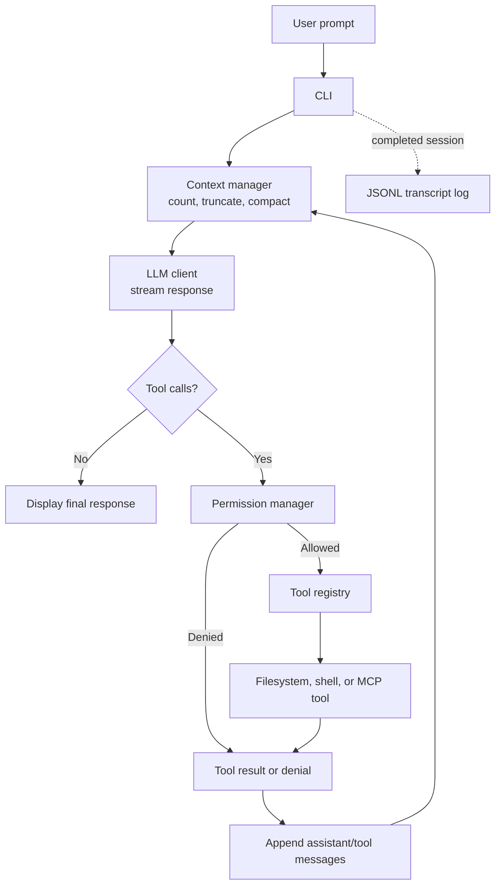

# Claude Code

Claude Code is a small, terminal-first coding agent built in Python. It connects a streaming LLM to a focused set of project-scoped tools, lets developers inspect proposed file changes before approving them, and keeps the agent loop easy to understand and extend. It is designed as a practical learning and portfolio project—not as a drop-in replacement for a production coding environment.

> **Demo:** add a short terminal recording here, for example ``.

## Features

- Stream model responses and let the agent call registered tools.
- Inspect files, search source, list directories, and find matching paths.
- Create and edit files with project-root path checks.
- Run shell commands with explicit approval by default and blocked dangerous command patterns.
- Use `/plan` to request a read-only plan before approving execution, and `/init` to generate project-specific `AGENT.md` guidance.
- Connect configured stdio MCP servers.
- Expose a typed asynchronous event stream for embedding the agent in another UI.
- Keep project root, message history, tool registry, and permission state on a per-session object.
- Compact long conversations and truncate oversized tool output to manage context.
- Run one prompt without an interactive terminal using `--prompt`.
- Append completed session transcripts as JSON Lines records to `~/.shree/logs/sessions.jsonl`.
- Run an eight-task coding evaluation suite in isolated temporary copies.

## Installation

Requirements: Python 3.10 or newer and a Groq API key.

```powershell
python -m pip install -e ".[dev]"
```

Configure the API key in your shell:

```powershell
$env:GROQ_API_KEY = "your-groq-api-key"
```

Alternatively, place `GROQ_API_KEY=...` in a local `.env` file in your project directory. Do not commit API keys or `.env` files.

Optional: set `ANTHROPIC_API_KEY` to use the Anthropic token-count endpoint for context usage reporting. Without it, the application estimates token usage from serialized text.

## Quick start

Start the interactive CLI:

```powershell
claude-code
```

Or run one non-interactive prompt:

```powershell
claude-code --prompt "Inspect this project and summarize its main modules."
```

Useful commands:

| Command | Action |
| --- | --- |
| `/plan <task>` | Build a plan using read-only tools. Approve, revise, or cancel it. |
| `/init` | Explore the repository and create/update root `AGENT.md` guidance. |
| `/clear` | Clear the active conversation from the current CLI process. |
| `/exit` | Exit the CLI. |
| `--yolo` | Skip mutating-tool approval prompts. Dangerous shell patterns remain blocked. |

Session transcript logs are local but may contain prompts, model replies, tool arguments, and tool output. Review and protect `~/.shree/logs/sessions.jsonl` accordingly.

## Tools

| Tool | Purpose | Default permission |
| --- | --- | --- |
| `read_file` | Read a project file with line numbers. | Read-only |
| `list_dir` | List entries in a project directory. | Read-only |
| `grep` | Search project files with a regular expression. | Read-only |
| `glob` | Find project paths using a glob pattern. | Read-only |
| `write_file` | Create or replace a project file. | Mutating; approval and diff preview |
| `edit_file` | Replace one exact, unique string in a project file. | Mutating; approval and diff preview |
| `bash` | Run a shell command in the project directory. | Mutating; approval |
| MCP tools | Add tools exposed by configured stdio MCP servers. | Mutating; approval |

Filesystem tools resolve paths under the selected project root and reject paths outside it. MCP server configuration is read from `.shree/mcp.json`; configured server commands run as local subprocesses.

## Permission model

Known read-only tools (`read_file`, `list_dir`, `grep`, and `glob`) run without a prompt. Other tools are treated as mutating. For `write_file` and `edit_file`, the CLI shows a unified diff before asking for approval. A user can approve once, always allow that tool for the current process, or deny it. `--yolo` bypasses mutating-tool prompts, so use it only when appropriate.

Some dangerous shell patterns (including selected destructive commands, `sudo`, and piping downloaded scripts directly to a shell) are blocked even in `--yolo` mode. These checks are safeguards, not a shell sandbox or a complete security boundary; do not run the agent with access to systems or data you are not willing to expose.

## Architecture



The CLI owns conversation history and rendering. The agent loop sends that history to the LLM client, routes requested calls through the permission manager and tool registry, appends results, then asks the model for the next response. The context manager may compact history before a model request.

`run_agent_events` is the async integration point. It yields typed events for streamed text, tool calls/results, permission requests, usage, errors, and completion. `WebPermissionHandler` suspends a turn until its caller submits a decision using the request ID. The synchronous `run_agent_loop` remains as a compatibility adapter for existing Python callers.

## Evaluation results

The repository contains eight starter tasks. No live evaluation results have been recorded yet; the results file is generated by the runner and requires a configured Groq API key. The current per-task status is therefore **not run**, not a passing score.

| Task | Status | Time | Tokens |
| --- | --- | --- | --- |
| `01_subtract` | Not run | — | — |
| `02_whitespace` | Not run | — | — |
| `03_clamp` | Not run | — | — |
| `04_word_count` | Not run | — | — |
| `05_palindrome` | Not run | — | — |
| `06_unique` | Not run | — | — |
| `07_safe_divide` | Not run | — | — |
| `08_key_value` | Not run | — | — |
| **Pass rate** | **Not available** | | |

Run the suite from the repository root:

```powershell
python evals\run_evals.py
```

Each task is copied into a temporary directory, the agent is invoked with `--prompt` and `--yolo`, and its `check.py` is run. The runner prints a pass/fail table and saves detailed output to `evals/results.json`. Token values marked with `~` are estimates. The eval runner makes model API calls and may incur usage charges.

## Tests

Run the test suite:

```powershell
python -m pytest
```

## Local web API

Install the project dependencies, then start the loopback-only API:

```powershell
python -m pip install -e ".[dev]"
shree serve
```

The server creates a fresh access token at startup and prints an authenticated
API URL. Keep the token private. SQLite data is stored in
`~/.shree/shree.db` by default. The API is intended for the local frontend
development origin `http://localhost:5173`; it is not designed to be exposed to
the public internet.

The `/api` endpoints cover chats and Markdown export, messages and SSE turns,
projects, global/project memory, settings, turn cancellation, permissions, and
context usage. Requests require the startup token as `X-Access-Token` or as a
Bearer token. The printed URL also supplies the token in its query string for
clients that cannot set request headers.

The chat-message SSE endpoint yields typed agent events. Permission requests
pause a turn until `POST /api/permissions/{request_id}` receives `allow_once`,
`allow_always`, or `deny`. Project roots must already exist as directories.

## Limitations

- This is an early-stage project; tool coverage and workflows are intentionally small.
- The web backend is a local API only; it does not include a frontend application or session-sharing protocol for remote users.
- Permission checks do not provide process isolation, and shell-pattern blocking cannot guarantee that every harmful command is detected.
- `--yolo` skips approval for mutating tools; use it only in a trusted environment.
- Context compaction summarizes older messages and preserves only a recent window, so details may be lost. Transcript logs are written for later inspection but are not automatically restored as active conversation context.
- Cancellation interrupts async model streaming and terminates the Bash subprocess group. A synchronous filesystem or MCP operation already in progress cannot be forcibly stopped; cancellation is observed when that operation returns.
- Input token counts may be estimates; output token counts are currently estimated from response text and tool-call data. Context percentage does not include exact provider-side overhead such as system/tool schemas.
- MCP server commands execute locally and are trusted configuration.
- Evaluation outcomes depend on the model and API availability; they are not a substitute for broader testing.
